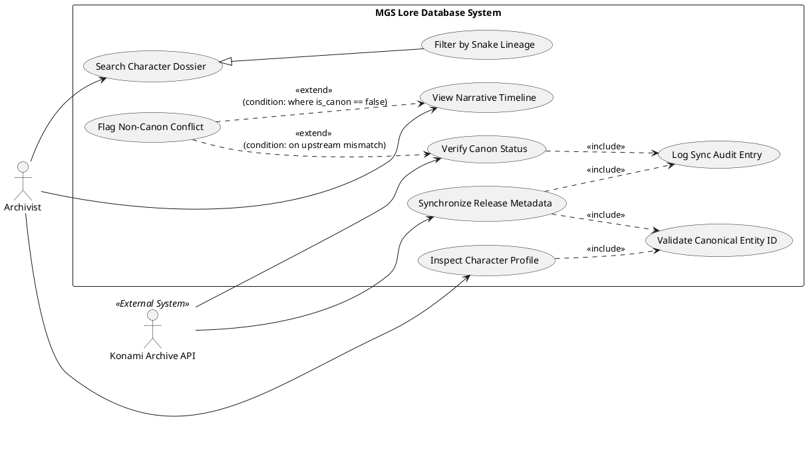

Нижче наведено повну специфікацію вимог, поведінкові сценарії, діаграму використання та матрицю трасування для системи бази даних лору *Metal Gear Solid* (MGS Lore DB).

---

## 1. Системні вимоги (EARS Patterns)

| ID | Патерн EARS | Формулювання вимоги |
| --- | --- | --- |
| **REQ-01** | **Ubiquitous** | The system SHALL maintain persistent records for entities `Character`, `Snake`, and `Game`, enforcing unique canonical identifiers for each entity. |
| **REQ-02** | **Ubiquitous** | The system SHALL log every metadata update and synchronization attempt with a timestamp and the response status code. |
| **REQ-03** | **Event-driven** | WHEN an Archivist requests a timeline view, the system SHALL sort and render all recorded `Game` entities strictly by their `chron_order` attribute in ascending sequence. |
| **REQ-04** | **Event-driven** | WHEN an Archivist queries the clone lineage of Big Boss, the system SHALL return all `Snake` entities linked via the *Les Enfants Terribles* project relationship. |
| **REQ-05** | **State-driven** | WHILE a synchronization session with the `Konami Archive API` is active, the system SHALL block manual metadata write operations on entities flagged for update. |
| **REQ-06** | **State-driven** | WHILE the network connection to `Konami Archive API` is in a disconnected state, the system SHALL serve cached canonical statuses with an explicit `stale_data: true` flag. |
| **REQ-07** | **Optional** | WHERE a `Character` entity has the subtype `Snake`, the system SHALL expose attributes for genetic lineage, clone type (`Solid`, `Liquid`, `Solidus`), and cellular degradation rate. |
| **REQ-08** | **Optional** | WHERE a `Game` record is marked as non-canon (`is_canon: false`), the system SHALL exclude its linked character events from the primary in-universe timeline. |
| **REQ-09** | **Ubiquitous (Out-of-Scope)** | The system SHALL automatically resolve narrative timeline paradoxes between contradictory game releases using generative AI summarization. *(Виділена непокрита вимога).* |

---

## 2. User Stories та приймальні тести (Gherkin)

### US-01: Хронологічний таймлайн операцій

**As an** Archivist,

**I want to** view games ordered by internal narrative chronology (`chron_order`),

**So that** I can follow the story from *Snake Eater* (1964) onwards, regardless of original release dates.

```gherkin
Feature: Chronological Timeline Rendering

  Scenario: Render game timeline ordered by in-universe timeline
    Given the database contains the following game records:
      | title                      | release_year | chron_order |
      | Metal Gear Solid           | 1998         | 3           |
      | Metal Gear Solid 3         | 2004         | 1           |
      | Metal Gear Solid: PW       | 2010         | 2           |
    When the Archivist requests the narrative timeline
    Then the system displays the games in the following order:
      | title                      |
      | Metal Gear Solid 3         |
      | Metal Gear Solid: PW       |
      | Metal Gear Solid           |
    And each entry shows both release_year and chron_order

```

---

### US-02: Каталогізація клонів родини Снейка

**As an** Archivist,

**I want to** filter character records specifically for the `Snake` entity type,

**So that** I can analyze clone attributes, original DNA sources, and final statuses.

```gherkin
Feature: Snake Clone Entity Lookup

  Scenario: Retrieve Les Enfants Terribles clone profiles
    Given an entity "Liquid Snake" exists with subtype "Snake" and progenitor "Big Boss"
    When the Archivist filters records by entity type "Snake" and lineage "Les Enfants Terribles"
    Then the result set contains "Liquid Snake"
    And the record displays clone type "Liquid", progenitor "Big Boss", and status "Deceased"

```

---

### US-03: Синхронізація канонічності через Konami Archive API

**As the** Konami Archive API,

**I want to** deliver upstream canonical status payloads to MGS Lore DB,

**So that** non-canonical entries or retcons are flagged without manual intervention.

```gherkin
Feature: Upstream Canon Synchronization

  Scenario: Automated verification flags non-canon release
    Given a local game entry "Metal Gear Survive" with status "Pending_Verification"
    When the Konami Archive API sends a sync payload with id "MG_SURVIVE" and "is_canon": false
    Then the system updates "Metal Gear Survive" attribute "is_canon" to false
    And the system logs the sync event with status 200 OK

```

---

## 3. Use Case діаграма (PlantUML)

Діаграма відображає:

* Двох акторів: **Archivist** (людина) та **Konami Archive API** (зовнішня система).
* Узагальнення акторів/прецедентів: базовий пошук `Search Dossier` спеціалізується у `Filter by Snake Lineage`.
* Зв'язки `<<include>>`: перегляд деталей або синхронізація обов'язково включають валідацію ідентифікаторів сутностей.
* Зв'язки `<<extend>>`: розширення перегляду хронології за умови виявлення конфлікту канонічності (`Flag Canon Conflict`).



---

## 4. Матриця трасування (Traceability Matrix)

Матриця демонструє зв'язки **багато-до-багатьох (M:N)** між системними EARS-вимогами та Use Case сценаріями.

| ID вимоги | Короткий опис вимоги | UC_Search / UC_FilterSnake | UC_Timeline | UC_Inspect | UC_SyncMeta | UC_VerifyCanon | Статус покриття |
| --- | --- | --- | --- | --- | --- | --- | --- |
| **REQ-01** | Сховище сутностей Character, Snake, Game | **X** | **X** | **X** | **X** |  | Покрита |
| **REQ-02** | Аудит та логування змін API |  |  |  | **X** | **X** | Покрита |
| **REQ-03** | Сортування за `chron_order` |  | **X** |  | **X** |  | Покрита |
| **REQ-04** | Запит генеалогії клонів Снейка | **X** |  | **X** |  |  | Покрита |
| **REQ-05** | Блокування запису під час активної сесії API |  |  |  | **X** | **X** | Покрита |
| **REQ-06** | Обслуговування кешу зі статусом stale | **X** | **X** | **X** |  | **X** | Покрита |
| **REQ-07** | Атрибути клонів для підтипу Snake | **X** |  | **X** |  |  | Покрита |
| **REQ-08** | Виключення неканонічних подій з таймлайну |  | **X** |  |  | **X** | Покрита |
| **REQ-09** | Автовирішення парадоксів через GenAI |  |  |  |  |  | Out-of-Scope (Непокрита) |

### Обґрунтування непокритої вимоги (Out-of-Scope Analysis)

* **Вимога REQ-09**: *"The system SHALL automatically resolve narrative timeline paradoxes between contradictory game releases using generative AI summarization."*
* **Причина виключення:** Вимога не покрита жодним сценарієм використання (Use Case) поточного релізу навмисно. Задача вирішення суперечностей канону (наприклад, реткони між *Metal Gear 2: Solid Snake* та *Metal Gear Solid V*) покладається на авторитетне джерело — **Konami Archive API** (прапорець `is_canon`) або експертне судження самого **Archivist**. Впровадження недетермінованих алгоритмів генеративного штучного інтелекту порушує цілісність реляційних зв'язків бази даних та виходить за межі сутностей першої лабораторної роботи (`Character`, `Snake`, `Game`).