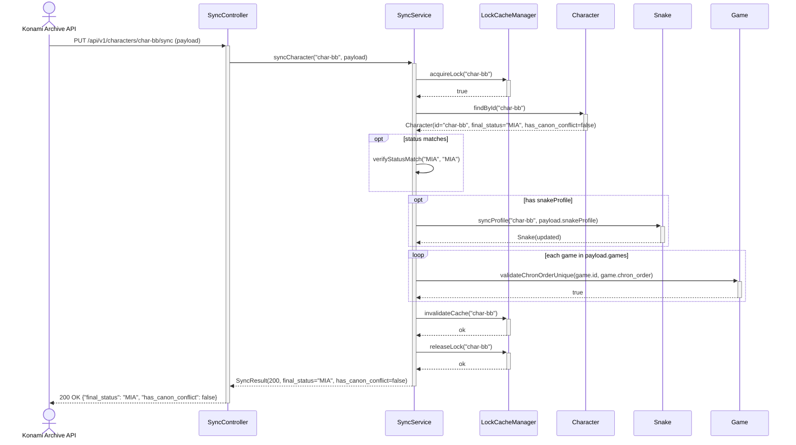
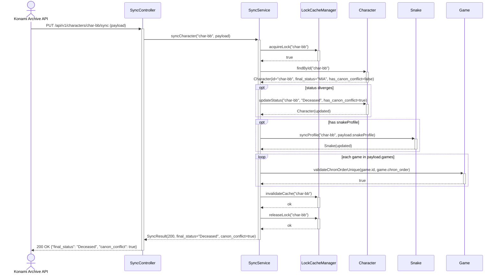
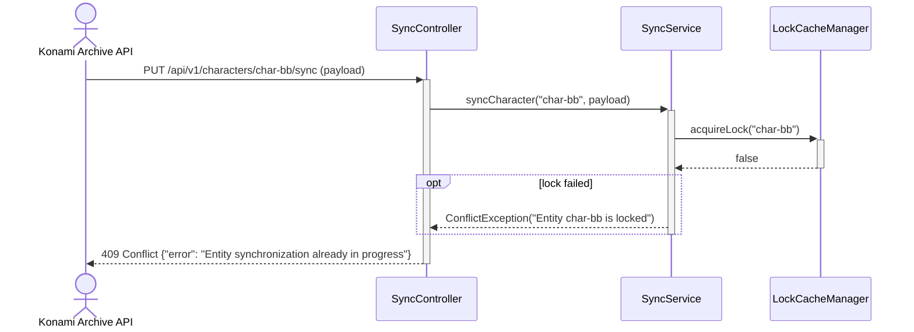
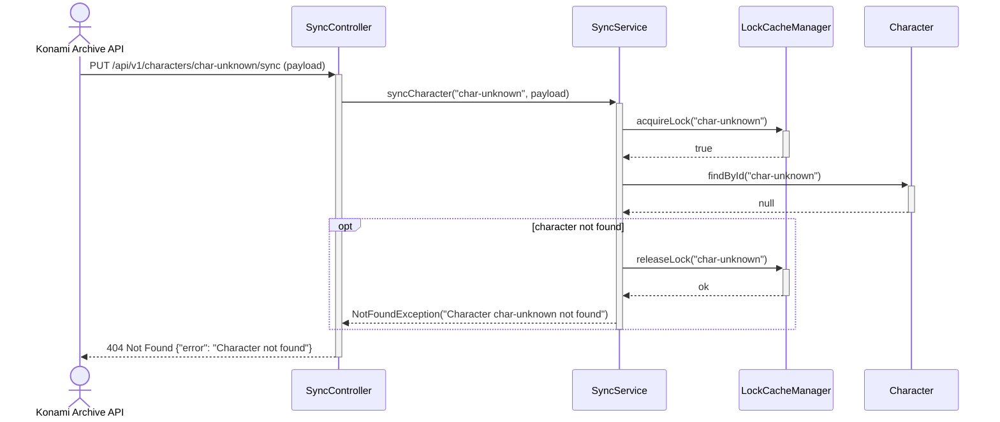

- :warning: == Scenario 1: Happy path (`200 OK` — статус збігається) ==

---

- :warning: == Scenario 2: Conflict path (`200 OK` — розбіжність статусів, `has_canon_conflict = true`) ==

---

- :warning: == Scenario 3: Lock / edge case (`409 Conflict` — запис заблоковано) ==

---

- :warning: == Scenario 4: Error path (`404 Not Found` — неіснуючий `character_id`) ==

